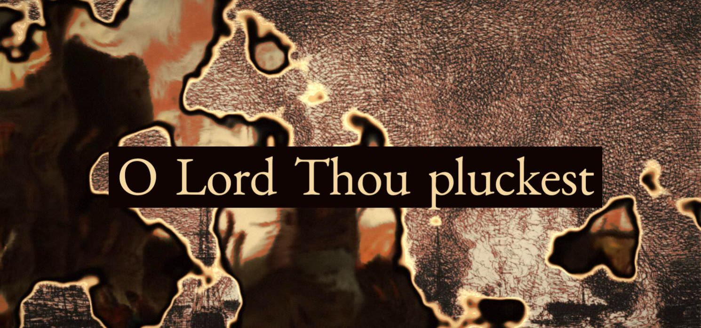

# A heap of broken images

**[Play it](https://lucadebort.github.io/ahobi-project/)** · about 24 minutes, best with headphones

T. S. Eliot reads *The Waste Land* in 1935. Under his voice, images, sounds and words move to one score, written line by line for the whole poem, from "April is the cruellest month" to the last "Shantih".

Move the mouse to see where you are in the poem and jump to any line. Adding `?t=<seconds>` to the address starts the piece at that moment.

## What you see

About 1,100 etchings, paintings, engravings and photographs from public domain collections, passing into one another through a WebGL feedback simulation. Each of the poem's 43 scenes has its own way of changing pictures and moving the camera: memories develop like a print in the tray, the river drowns them, the dry rock turns them to dust, the Fire Sermon burns through the film, the thunder's DA arrives in a flash. Most changes are a slow melt, and hard cuts are kept for the words that call for them, like the Tarot cards or the falling cities.

The lines of the poem appear as Eliot says them, timed to his reading word by word.

## What you hear

Eliot's 1935 reading carries the piece. Under it runs a slow music made from old recordings: the third act of *Tristan und Isolde* from Bayreuth in 1928 and an acoustic recording of the Liebestod from 1913, stretched many times slower until they turn into drones. Where the poem quotes Wagner, the opera itself plays. On a few words ("Unreal City", the last "burning", the three DA, "Shantih") Eliot's own voice is frozen and held under what follows, and the picture freezes with it.

## How it's made

- One hand-written score drives everything: the word timings of the reading, and for each scene its pool of images, its passages, camera moves, sounds and effects.
- The voice is the clock. Images, words and music follow it, so pausing and seeking keep everything in step.
- Pictures are drawn by a WebGL2 feedback simulation, and the envelope of the music makes them breathe.
- The drones are rendered offline with a paulstretch written in TypeScript.
- Next.js and TypeScript, exported as a static site. This repository holds the built site.

## Credits

- **Voice:** T. S. Eliot reading *The Waste Land*, 1935.
- **Images:** Wikimedia Commons (655), Cleveland Museum of Art Open Access (301), The Metropolitan Museum of Art Open Access (117), Wellcome Collection (37). Every image is public domain or CC0. Title, artist, date, licence and source page for each one are in [`library/credits.json`](library/credits.json).
- **Music:** Richard Wagner, *Tristan und Isolde*, act III, Bayreuth Festival 1928, conducted by Karl Elmendorff (Columbia, via the Internet Archive). *Liebestod*, Victor Herbert's Orchestra, 1913.
- **Inspirations:** [Symphony in Acid](https://symphonyinacid.net) for the idea of a single score driving a piece in the browser; *Zauberberg* by Kassel Jaeger, Stephan Mathieu and Akira Rabelais for the music.

## History

This repository used to host the call for a collaborative version of the project, where each contributor received a line of the poem by email and made an image for it. That page is still in the history at commit `516a7e9`.

---

These fragments I have shored against my ruins
